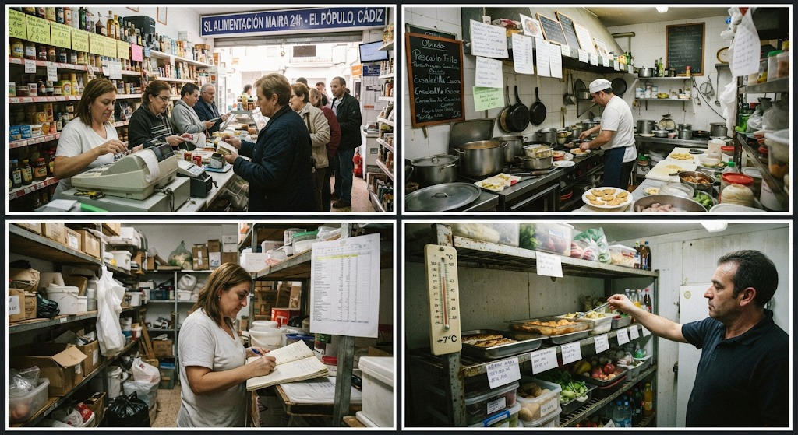

# Ficha de la empresa

## Datos generales
- **Nombre:** SL Alimentación Maira 24h
- **Sector:** Alimentación (es un comercio minorista de elaboración propia)
- **Ubicación:** barrio del Pópulo de Cádiz
- **Tamaño:** microempresa, 6-8 empleados en turnos para cubrir las 24 horas
- **Facturación anual aproximada:** 350.000 €

## Áreas de la empresa
- **Planta (OT):** obrador propio (platos del día, tortillitas, pescaíto frito, ensaladilla, embutidos), cámaras frigoríficas y almacén.
- **Negocio (IT):** tienda, caja, compras a proveedores, gestión de stock y atención al cliente.

## Productos y clientes
- **Productos:** comestibles, bebidas, productos frescos y platos preparados del obrador.
- **Clientes:** vecinos del barrio, trabajadores de turno de noche y turistas.

## Situación digital actual
Caja registradora básica, pedidos a proveedores por teléfono o WhatsApp e inventario en cuaderno o Excel.

## Problemas actuales
1. **Problemas por caducidad** en productos frescos y platos preparados.
2. **Fallos en las cámaras frigoríficas** que se detectan tarde, con riesgo de perder productos.
3. **Compras a ojo:** se pide de más o se queda sin stock de lo que más se vende.